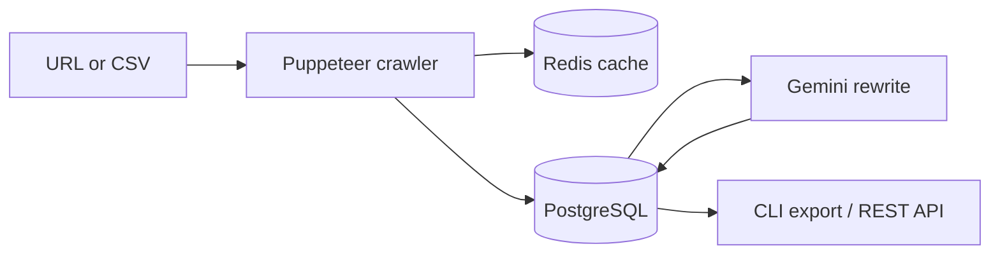

# Bloggen-AI

A Node.js prototype that turns existing web articles into rewritten blog content. It crawls a URL with headless Chromium, stores the extracted text in PostgreSQL, and asks Google Gemini to rewrite it in a style you choose ("professional", "conversational and friendly", and so on). It ships as a command-line tool for single URLs, CSV batches and scheduled runs, plus a small REST API over the stored articles.

## Overview

**Problem.** Re-purposing an article for a blog means copying the text, cleaning out navigation and ads, and rewriting it in a consistent voice.

**Approach.** Bloggen-AI automates that pipeline:

1. **Crawl** — Puppeteer loads the page, removes `script`, `style`, `header`, `footer`, `nav`, ads, comments and sidebars, then takes the first `h1` (or the page title) and the remaining body text.
2. **Store** — the article is saved with its source URL, category and requested style (Prisma + PostgreSQL).
3. **Rewrite** — the text (truncated to 10,000 characters) is sent to the Gemini `gemini-2.0-flash` `generateContent` REST endpoint with a Vietnamese prompt asking it to rewrite the content in the requested style, improving clarity without changing the facts and keeping the title.
4. **Export** — rewritten articles can be exported as JSON, Markdown or HTML.



## Key features

- **CLI (`bloggen`)** built with Commander: `init`, `crawl`, `batch`, `list`, `export`, `schedule` (`src/cli`).
- **Batch processing** — reads a CSV with `category,url,style` columns and processes rows in parallel with a pool of `worker_threads` workers (CPU count − 1) (`src/services/csv.js`, `src/utils/wokerPool.js`, `src/utils/worker.js`).
- **Duplicate check and caching** — batch workers skip URLs already in the database; crawled page text is cached in Redis for 24 hours, keyed by an MD5 hash of the URL (`src/utils/worker.js`, `src/services/cache.js`).
- **Rate limiting** — in-process token buckets: 5 Gemini calls and 10 crawls per minute (`src/utils/rateLimiter.js`).
- **Retries** — crawl retries up to 3 times with exponential backoff (`src/services/crawler.js`).
- **Scheduling** — `node-cron` runs the CSV batch on a cron expression and writes a report to `logs/` (`src/cli/commands/schedule.js`).
- **Export** — JSON, Markdown or HTML, for all articles, one category or one article (`src/cli/commands/export.js`).
- **REST API** — Express endpoints to list, read, crawl and re-process articles and manage categories (`src/api`).

## Tech stack

| Layer | Technology |
| --- | --- |
| Runtime | Node.js (CommonJS) |
| CLI | Commander 11, ora, chalk |
| Crawling | Puppeteer (headless Chromium) |
| AI | Google Gemini API (`gemini-2.0-flash`) via axios |
| Database | PostgreSQL, Prisma 5.22 |
| Cache | Redis via ioredis |
| Concurrency | Node `worker_threads` |
| Scheduling | node-cron |
| API | Express 4.21 |

## Project structure

```text
.
├── prisma/schema.prisma      # Category and Article models
├── src/
│   ├── index.js              # Starts the REST API
│   ├── api/                  # Express app and routes (articles, categories)
│   ├── cli/                  # bloggen CLI entry point and commands
│   ├── services/             # crawler, ai (Gemini), cache (Redis), csv, database
│   └── utils/                # rate limiter, worker pool, worker thread
├── urls.csv                  # Sample batch input
├── output/, .output/         # Sample exports from early local runs
├── logs/                     # Sample scheduled-run report
└── .cache/                   # Files from an earlier file-based cache (no longer used)
```

`output/`, `.output/`, `logs/` and `.cache/` are artifacts from local test runs and are not needed to run the tool.

## Data model

- `Category` — `id`, `name` (unique), timestamps.
- `Article` — `id`, `title`, `originalContent`, `processedContent`, `sourceUrl`, `styleRequest`, `categoryId` → `Category`, timestamps.

## Getting started

### Prerequisites

- Node.js 18+ and npm (the repo uses `package-lock.json`)
- PostgreSQL
- Redis on `127.0.0.1:6379` (the host and port are hard-coded in `src/services/cache.js`)
- A Google AI Studio (Gemini) API key

### Install

```bash
npm install
```

`puppeteer` and `ioredis` are imported by the code but are not yet listed in `package.json`, so install them too:

```bash
npm install puppeteer ioredis
```

### Configure

```bash
cp .env.example .env
```

Alternatively, `node src/cli/index.js init` writes a template `.env` and tests the database connection.

### Database

```bash
npx prisma generate
npm run migrate        # prisma migrate deploy
```

### Use the CLI

```bash
# One URL
node src/cli/index.js crawl https://example.com/article --style "conversational and friendly" --category Technology

# A CSV batch (columns: category,url,style)
node src/cli/index.js batch ./urls.csv

# List stored articles
node src/cli/index.js list

# Export (json | md | html)
node src/cli/index.js export --format md --output ./export

# Run the CSV batch on a schedule (daily at midnight by default), or once
node src/cli/index.js schedule --file ./urls.csv --cron "0 0 * * *"
node src/cli/index.js schedule --file ./urls.csv --once
```

Run `npm link` once if you prefer calling it as `bloggen`.

### Run the API

```bash
npm start      # or: npm run dev (nodemon)
```

The API listens on `http://localhost:3000/api` (or `PORT`).

## Environment variables

| Name | Required | Description |
| --- | --- | --- |
| `DATABASE_URL` | Yes | PostgreSQL connection string for Prisma |
| `GOOGLE_STUDIO_LLM_API_KEY` | Yes | Gemini API key used for rewriting |
| `PORT` | No | API port (default `3000`) |
| `NODE_ENV` | No | When `development`, error messages are included in 500 responses |

## API reference

None of the endpoints require authentication.

| Method | Path | Auth | Description |
| --- | --- | --- | --- |
| GET | `/api/categories` | None | List categories with article counts |
| GET | `/api/categories/:id` | None | Category with its articles |
| POST | `/api/categories` | None | Create a category (`name`) |
| GET | `/api/articles?page=&pageSize=` | None | Paginated articles, newest first |
| GET | `/api/articles/:id` | None | One article |
| GET | `/api/articles/search` | None | Search by `query` and `categoryId` (currently shadowed by `/:id`, see below) |
| POST | `/api/articles/crawl` | None | Crawl `url`, save under `categoryName`, rewrite with `style` |
| POST | `/api/articles/:id/process` | None | Re-run the Gemini rewrite for an article |

## Known limitations

- This is a prototype with no tests.
- `GET /api/articles/search` is registered after `GET /api/articles/:id`, so requests to `/search` are handled by the `:id` route and fail.
- The API has no authentication, and `POST /api/articles/crawl` will fetch any URL it is given; do not expose it publicly.
- On a Redis cache hit, `crawlAndSave` returns the cached `{ title, content }` without an article ID, so re-crawling the same URL within 24 hours stops before the AI step.
- Rate limits are kept in memory per process, so each worker thread has its own budget.
- The Redis connection is hard-coded to `127.0.0.1:6379`.
- `@mozilla/readability`, `jsdom`, `cheerio`, `cors` and the `worker-threads` npm package are listed as dependencies but not used.
- Crawled articles belong to their original publishers; check each site's terms before republishing rewritten content.

## Author

**Lê Văn Trung Tính** — Software Engineer | AI Product Builder

- Website: [trungtinh.site](https://trungtinh.site)
- GitHub: [@tinhne](https://github.com/tinhne)
